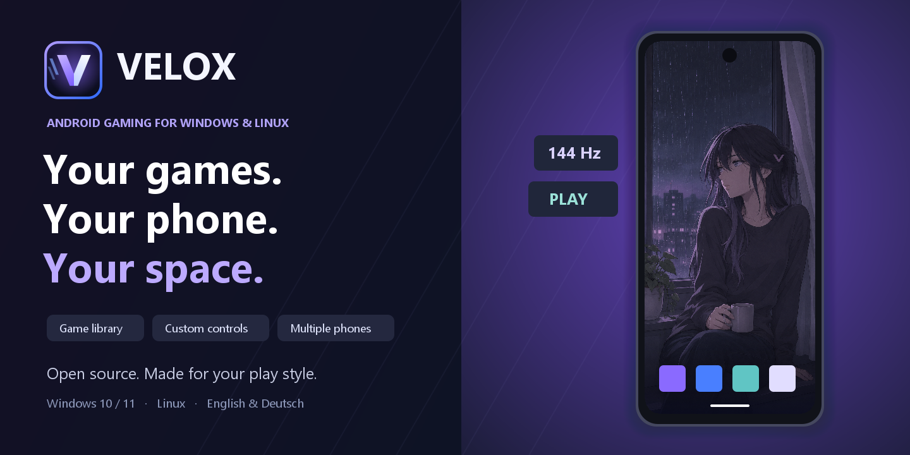

<p align="center"></p>

<p align="center"><a href="https://github.com/NeTriXoN-BoT/velox/releases/latest/download/Velox-Setup-2.3.1.exe"><b>Windows-Installer herunterladen</b></a> &nbsp;·&nbsp; <a href="https://github.com/NeTriXoN-BoT/velox/releases/latest/download/Velox-2.3.1.zip"><b>Portable ZIP herunterladen</b></a> &nbsp;·&nbsp; <a href="README.md">English</a></p>

> [!IMPORTANT]
> **Windows-Herausgeberwarnung:** `Velox.exe` und der Installer sind derzeit **nicht signiert**. Windows kann **„Unbekannter Herausgeber“** oder **„Der Computer wurde durch Windows geschützt“** anzeigen.
> Prüfe vor dem Öffnen den SHA-256-Wert anhand der [SHA256SUMS.txt aus derselben Version](https://github.com/NeTriXoN-BoT/velox/releases/download/v2.3.1/SHA256SUMS.txt). Hier findest du die [Anleitung zur Dateiprüfung und zur Windows-Warnung](docs/VERIFY-DOWNLOADS.de.md).

<details>
<summary>Vor der Installation prüfen (PowerShell)</summary>

Lade die Datei und `SHA256SUMS.txt` aus demselben offiziellen Release herunter. Öffne PowerShell im Downloadordner und führe **nur den Befehl für deine heruntergeladene Datei** aus:

Installer:

```powershell
Get-FileHash -LiteralPath '.\Velox-Setup-2.3.1.exe' -Algorithm SHA256 | Format-List Algorithm,Hash
```

Portable ZIP:

```powershell
Get-FileHash -LiteralPath '.\Velox-2.3.1.zip' -Algorithm SHA256 | Format-List Algorithm,Hash
```

Vergleiche alle 64 Zeichen unter `Hash` mit der Zeile für genau diesen Dateinamen in `SHA256SUMS.txt`. Groß- und Kleinschreibung sind dabei egal. Bei einer Abweichung darfst du die Datei nicht öffnen oder installieren. Ein Treffer bestätigt die Übereinstimmung mit dem veröffentlichten Release; er bestätigt weder die Unbedenklichkeit noch einen verifizierten Herausgeber.

Wenn du Quelle und Prüfsumme geprüft hast und fortfahren möchtest, kannst du bei einer SmartScreen-Warnung **Weitere Informationen → Trotzdem ausführen** wählen, sofern Windows diese Option anbietet. Deaktiviere keinen Windows-Schutz und umgehe keine Administratorrichtlinie. Bei einer konkreten Virenmeldung brich ab. [Vollständige Anleitung](docs/VERIFY-DOWNLOADS.de.md).

</details>

Velox ist ein quelloffenes Android-Gaming-Handy für Windows. Ein echtes Android 15 mit Google Play trifft auf eine eigene Desktop-Oberfläche mit Spielebibliothek, Tastatur- und Mausbelegung, Controller-Unterstützung, mehreren unabhängigen Handys und Wiederherstellung.

### Loslegen

1. Lade den Installer oder die portable ZIP herunter und [prüfe die Datei vor dem Öffnen](docs/VERIFY-DOWNLOADS.de.md). Installiere Velox anschließend für dein Windows-Konto oder entpacke die ZIP in einen beschreibbaren Ordner.
2. Öffne Velox, wähle Deutsch oder Englisch und akzeptiere die SDK-Bedingungen von Google. Android wird automatisch heruntergeladen und eingerichtet.
3. Aktiviere bei Bedarf die Windows-Hypervisor-Plattform und starte Windows neu. Virtualisierung muss auch im UEFI/BIOS eingeschaltet sein.
4. Das Haupthandy startet nach der Einrichtung. Melde dich bei Google Play an und installiere deine Spiele.

Vorausgesetzt werden ein Intel-/AMD-PC mit **Windows 10 ab Version 2004 oder Windows 11 (x64)**, etwa **10 GB freier Speicher** und Internet für ungefähr **2,2 GB Downloads**. Spiele, weitere Handys und Backups brauchen zusätzlichen Speicher. Windows auf ARM wird nicht unterstützt. Ein manuell installiertes Android SDK ist zum Spielen nicht nötig.

### Deine Spielumgebung

- **Bibliothek:** Suche, Favoriten, zuletzt gespielte Titel und eigene Einstellungen pro Spiel.
- **Control Studio:** Tasten, WASD, Wischbewegungen und Maussteuerung; Belegungen pro Spiel und Ausrichtung.
- **Controller:** XInput und DirectInput, natives Android-Gamepad oder Touch-Belegung, Totzonen und Vorschau.
- **Mehrere Handys:** Ein Haupthandy und bis zu acht weitere Profile teilen sich das SDK. Apps, Konten, Spielstände und Einstellungen bleiben getrennt. Die gleichzeitige Nutzung richtet sich nach den verfügbaren Ressourcen.
- **Leistung:** Hardware-Erkennung, GPU-Grafik und bis zu 144 Hz. Bis zu 64 virtuelle CPUs und 64 GB RAM sind einstellbar, soweit Host und Android-Engine dies unterstützen. Nicht verfügbare Optionen sind deaktiviert; Windows behält Arbeitsspeicher.
- **Anzeige:** Automatische Ausrichtung, Auflösung, Gesten und beide Reihenfolgen der drei Navigationstasten. Umgekehrte Tasten benötigen optionales Root.
- **Velox Home und Einstellungen:** Optionaler Android-Startbildschirm und abgestimmte Einstellungen auf Deutsch oder Englisch.
- **Wiederherstellung:** Geprüfte Backups bei ausgeschaltetem Handy, getrennt vorbereitete Wiederherstellung und Rückgängig-Funktion. Das ursprüngliche Handy bleibt erhalten.
- **Gestaltung:** Eigene Werkzeugleiste, Cursor, Startanimationen, vier unterschiedliche Velox-chan-Hintergründe und eigene Bilder.

Velox wählt sichere Voreinstellungen. **Handy → Handy mit Velox starten** steuert den automatischen Start des Haupthandys. Bestehende Einstellungen werden beibehalten. Weitere Handys starten nur auf Anforderung.

### Daten und Kompatibilität

Velox benötigt kein eigenes Konto und enthält keine Telemetrie. Angeforderte Downloads und die Prüfung signierter Programmaktualisierungen nutzen das Internet. Für Android und Google Play gelten eigene Bedingungen. Google-Pakete werden nach Zustimmung direkt von Google geladen und geprüft; sie liegen nicht im Downloadpaket und werden nicht ungefragt ersetzt.

Wenn du nur das Bedienfenster schließt, läuft das Handy weiter. **Handy stoppen** fährt dieses Handy herunter. Installer-Updates und Deinstallation behalten Handydaten und Einstellungen. **Backups sind nicht verschlüsselt** und enthalten private App- und Kontodaten.

Spiele können Emulatoren, Eingabebelegungen oder Root einschränken. Root ist optional und kann Play Integrity beeinträchtigen. Der native Controller-Modus stellt ein Gamepad pro Handy bereit; Rumble und Host-Bewegungssensoren sind nicht implementiert.

Echte Android-Tests auf dem verfügbaren PC umfassten bis zu 32 aktive CPUs und 32 GB RAM. Die 64er-Einstellungen und Startparameter sind geprüft; ein Gast mit 64 CPUs bzw. 64 GB wurde auf entsprechend leistungsfähiger Hardware noch nicht validiert. Die Windows-Dateien besitzen derzeit keine Authenticode-Signatur. Lade sie aus den offiziellen Releases und [prüfe vor dem Öffnen ihre SHA-256-Prüfsummen](docs/VERIFY-DOWNLOADS.de.md).

[Bauanleitung](docs/BUILD.md) · [Architektur](docs/ARCHITECTURE.md) · [Mitwirken](CONTRIBUTING.md) · [Änderungen](CHANGELOG.txt) · [Fehler melden](https://github.com/NeTriXoN-BoT/velox/issues)

Der eigene Quellcode und die mitgelieferten eigenen Grafiken stehen unter der [MIT-Lizenz](LICENSE.txt). Drittanbieter behalten ihre jeweiligen [Lizenzen](release/THIRD-PARTY-NOTICES.txt). Velox ist ein unabhängiges Projekt und gehört nicht zu Google oder Android.
