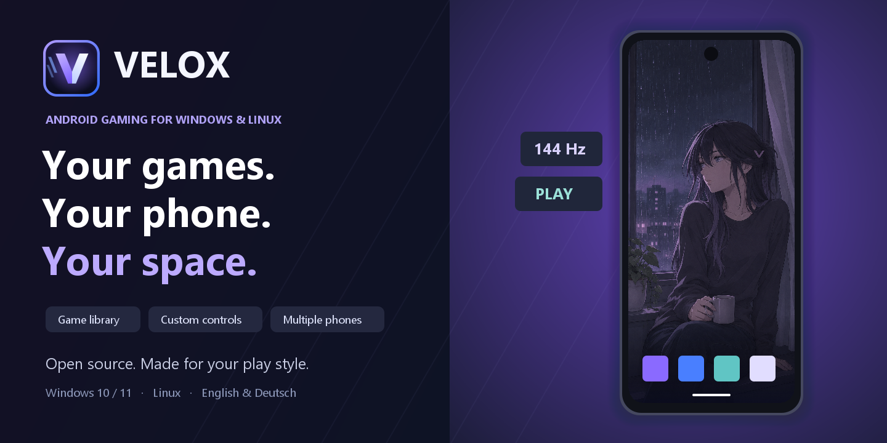

<p align="center"></p>

<p align="center">
  <a href="https://github.com/NeTriXoN-BoT/velox/releases/latest/download/Velox-Setup-2.3.1.exe"></a>
  &nbsp;
  <a href="https://github.com/NeTriXoN-BoT/velox/releases/latest/download/Velox-2.3.1.zip"></a>
</p>

> [!IMPORTANT]
> **Windows publisher warning:** `Velox.exe` and the installer are currently **unsigned**. Windows may show **“Unknown publisher”** or **“Windows protected your PC.”**
> Before opening a download, check its SHA-256 against [SHA256SUMS.txt from the same release](https://github.com/NeTriXoN-BoT/velox/releases/download/v2.3.1/SHA256SUMS.txt). Follow the [verification and Windows warning guide](docs/VERIFY-DOWNLOADS.md) ([Deutsch](docs/VERIFY-DOWNLOADS.de.md)).

<details>
<summary>Quick check before installing (PowerShell)</summary>

Download the file and `SHA256SUMS.txt` from the same official release. Open PowerShell in the folder containing your download and run **only the command for the file you downloaded**:

Installer:

```powershell
Get-FileHash -LiteralPath '.\Velox-Setup-2.3.1.exe' -Algorithm SHA256 | Format-List Algorithm,Hash
```

Portable ZIP:

```powershell
Get-FileHash -LiteralPath '.\Velox-2.3.1.zip' -Algorithm SHA256 | Format-List Algorithm,Hash
```

Compare all 64 characters in `Hash` with the line for that filename in `SHA256SUMS.txt`; upper/lowercase does not matter. If they differ, do not open or install the file. A match confirms that it matches the published release; it does not certify that software is safe or provide a verified publisher.

After checking the source and hash, if you choose to proceed and SmartScreen offers it, select **More info → Run anyway**. Do not disable Windows protection or bypass an administrator's policy. Stop if antivirus reports a specific threat. [Full instructions](docs/VERIFY-DOWNLOADS.md).

</details>

<p align="center">
  <a href="https://github.com/NeTriXoN-BoT/velox/releases"></a>
  
  <a href="LICENSE.txt"></a>
  <a href="https://github.com/NeTriXoN-BoT/velox/actions/workflows/checks.yml"></a>
</p>

<p align="center"><b>English · <a href="README.de.md">Deutsch</a></b> &nbsp;|&nbsp; <a href="docs/BUILD.md">Build from source</a> &nbsp;|&nbsp; <a href="CHANGELOG.txt">Changelog</a> &nbsp;|&nbsp; <a href="https://github.com/NeTriXoN-BoT/velox/issues">Report an issue</a></p>

Velox is an open-source Android gaming workspace for Windows. It brings a real Android 15 phone with Google Play into a custom desktop interface, with a game library, input mapping, controllers, independent phones and recovery tools.

The launcher is native C++ and Win32. Android components download directly from Google after you accept the SDK terms. No separate SDK installation is needed for playing.

### Built around your games

| Feature | What you get |
| :-- | :-- |
| **Game library** | Installed apps, search, favorites, recent games and per-game presets. |
| **Control Studio** | Keyboard/mouse taps, WASD sticks, swipes and mouse aim, saved per game and orientation. |
| **Controllers** | XInput and DirectInput, native Android gamepad mode or touch mapping, dead zones and live preview. |
| **Independent phones** | A main phone and up to eight additional profiles, sharing the SDK while keeping apps, accounts, saves and controls separate. |
| **Adaptive performance** | Hardware-aware recommendations, GPU graphics, up to 144 Hz, and configurable CPU/RAM allocations with Windows headroom. |
| **Display and navigation** | Automatic game orientation, resolution controls, gestures or either three-button order. Reversed buttons require optional root. |
| **Velox Home and Settings** | Optional Android home screen, coordinated preferences, English and German, and access to Android settings. |
| **Recovery** | Verified cold backups, staged restore, interrupted-restore recovery and Undo while preserving the original phone. |
| **Your look** | Custom toolbar, cursors, boot screens, four distinct Velox-chan wallpapers and your own pictures. |
| **Convenient imports** | APK, APKS, XAPK, APKM, OBB and ordinary files; screenshots and recordings from the toolbar. |

### Get started

1. Download the **installer** or **portable ZIP** and [verify it before opening](docs/VERIFY-DOWNLOADS.md). Then run the installer for a per-user installation, or extract the ZIP into a writable folder.
2. Open **Velox**, choose English or Deutsch, and accept Google's SDK terms to download and set up Android.
3. If prompted, enable Windows Hypervisor Platform and restart. Virtualization must also be enabled in firmware.
4. The main phone starts after setup. Sign in to Google Play and install your games.

Plan for about **2.2 GB of first-run downloads** and **10 GB of free storage**. Use an Intel/AMD **x64 Windows 10 (2004 or newer) or Windows 11** PC. Additional games, phones and backups need more storage. Windows on ARM is not supported.

Velox chooses conservative defaults and starts the main phone when you open it after setup. You can change that in **Phone → Start phone with Velox**. Existing configurations retain their startup behavior. Each additional phone starts only when requested.

### Performance that respects the host

CPU and RAM choices reach **64 virtual CPUs and 64 GB RAM**, subject to your host and Android engine limits. Unsupported choices are disabled, other active phones count toward the budget, and RAM is reserved for Windows. Auto uses at most 6 CPUs and 8 GB. More resources do not always improve a game.

The hardware summary shows physical cores, logical threads, GPU, RAM, desktop resolution and refresh rate. **Use recommended** considers the current monitor, graphics type, available memory and other running phones. Android's observed CPU capacity is checked after boot.

### Keep your data yours

There is no telemetry or account required by Velox. Network access is used for requested downloads, signed application update checks and the Android phone's own services. The Android image and Google Play have their own terms and network behavior.

Settings and phone data live beside Velox where writable; see the [portable guide](release/README.txt). Closing the controls leaves its Android phone running. Use **Stop phone** to shut that phone down. Installer upgrades and uninstall preserve phone data and settings. Backups contain private account/app data and **are not encrypted**.

Official application updates use signed manifests and checked downloads. Google SDK packages are downloaded separately from Google, pinned to tested versions and checked before use; they are not bundled in the release or silently replaced.

### Compatibility and limits

- Game support varies. Some games restrict emulators, mapped input or rooted phones. Velox does not bypass those restrictions.
- Root is optional. Magisk/rootAVD download and setup are separate; root may affect banking apps, games and Play Integrity.
- Native controller mode exposes one gamepad per phone. Rumble and host motion sensors are not implemented. Check your device in Controller Studio.
- Real-guest validation covered up to 32 online CPUs and 32 GB RAM on the available host. The 64-unit settings and command construction were tested, but a 64-CPU/64-GB guest has not been validated on suitable hardware.
- Windows release binaries are currently unsigned with Authenticode. Windows may show a publisher warning; obtain files from this repository's releases and verify the supplied SHA-256 checksums.

### Contribute

See [building](docs/BUILD.md), [contributing](CONTRIBUTING.md), [architecture](docs/ARCHITECTURE.md) and [security](SECURITY.md). Reproducible steps and redacted diagnostics make bug reports useful. Please keep accounts, tokens, phone numbers, saves and personal paths out of public issues.

Velox's original code and included original assets use the [MIT license](LICENSE.txt). Third-party components retain their licenses; see [notices](release/THIRD-PARTY-NOTICES.txt), [rootAVD](third_party/rootAVD/SOURCE.txt) and [navigation](navigation/README.md). Velox is an independent project and is not affiliated with Google or Android.
