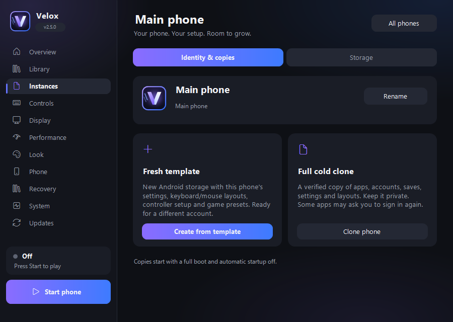

# Your phones, your setup

[Deutsch](PHONE-MANAGEMENT.de.md) · [Back to Velox](../README.md)

Open **Instances → Manage** on a phone. Names, storage and copies belong to that phone; Android's shared SDK remains separate.

### Name, template or full clone

**Rename** changes the visible name without changing storage identity. **Fresh template** creates new Android storage and carries over preferences, both control orientations, controller preferences and game presets. It starts without accounts or installed apps from the source.

**Full cold clone** copies the stopped phone's disks and checksums, then validates and updates their backing paths. It includes private apps, accounts and saves. Keep clones private. Some apps may require another sign-in, and using the same game account simultaneously may be restricted by that game. A template is a useful starting point for a different account.

Stop the source phone and close its other controls before copying. New copies have automatic startup off and use a full boot. The main phone plus eight additional phones remain the limit; simultaneous use also depends on available CPU and memory. RAM settings remain guest targets; the budget reserves at least 3 GB per active phone to cover the pinned Android image's minimum. Process and graphics overhead are additional.

### Storage with a way back

**Storage** shows logical phone-file size, allocated disk space, desktop data and known disposable files. The shared SDK and Vault backups are excluded from phone usage. Sparse disk files can use less physical space than their logical size.

**Review cleanup** lists the known targets before moving snapshots, cache and logs to Windows' Recycle Bin. It keeps app/save disks. Empty those specific Bin items yourself to reclaim space.

**Choose drive** creates and verifies a new phone copy on a local fixed drive, updates its disk references and switches preferences only after success. The original stays on disk. **Undo move** returns to its earlier state; newer changes remain in the moved copy. **Previous copy** opens the original AVD folder. Test the new copy before managing the old folder yourself; keep the shared SDK and other phones. Cancelling a copy preserves the source and reports where incomplete output remains.

### Share controls, keep data private

Open **Controls → Share game setup**. Export includes saved portrait/landscape bindings, controller preferences and the per-game preset in a readable `.velox-controls` file. It excludes accounts, saves, local SDK paths and controller device IDs.

Import reviews the Android package first and replaces only that game's saved setup. Unsupported CPU or RAM choices fall back to global settings. Previous files remain in `data/layout-history`; **Undo last setup import** restores them. An interrupted import rolls back on reopening Velox. Close Control Studio before importing or undoing.

### Quiet background phones

Open **Performance → Background mode**. Optionally choose a 15, 30 or 60 FPS Android display preference and mute this phone's Windows audio session while another app or phone is active. Normal FPS and the previous mute state return on focus or closing controls. Other applications and Android's own volume stay independent. Games may manage rendering differently; the setting is a display preference. These options apply while that phone's controls remain open.

### Backups and startup care

Open **Recovery → Schedule & repair** for **Velox Care**. Daily/weekly schedules run only while that phone is stopped and its controls are open. They never stop an active game. Both the recovery-count limit and logical GB budget apply to this phone's scheduled backups; manual backups remain separate.

At a limit or after an error, the schedule pauses. Move older scheduled backups out of the vault, fix the cause or raise a limit, then choose **Resume schedule**. No recovery point is deleted automatically. Backups and full clones contain private data and are **not encrypted**.

**Cancel startup** stops only the emulator owned by that phone's startup. **Startup repair** verifies Google's tools, rebuilds the device configuration and bypasses stale quick-boot state. It keeps apps, accounts, saves and selected performance preferences. Missing disks require a verified Vault restore; repair does not wipe or recreate them.
